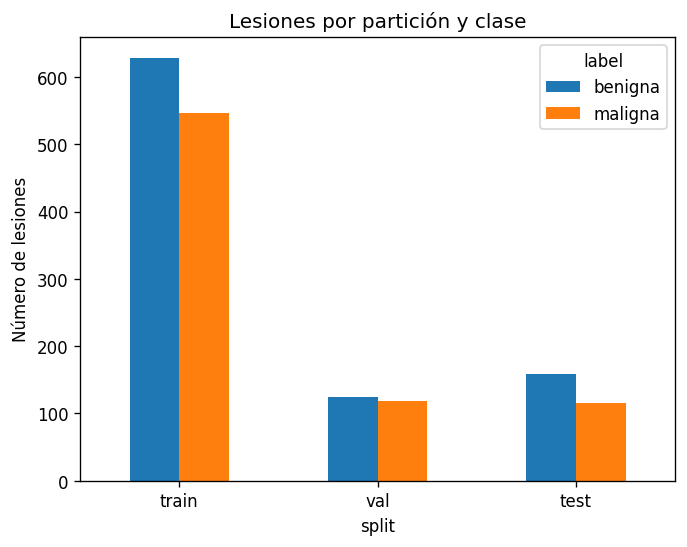
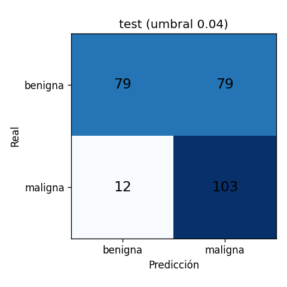
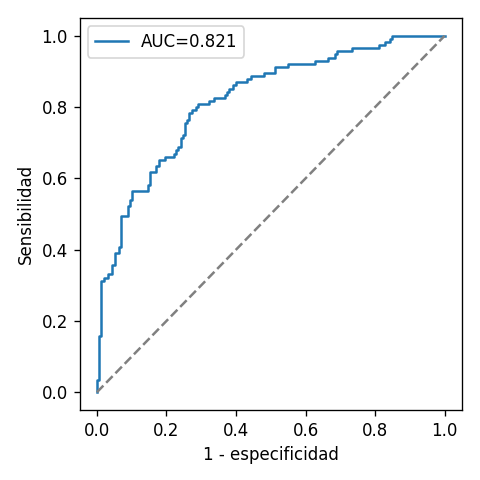

> **Prototipo académico; no apto para diagnóstico ni decisiones clínicas.**
> Repositorio: https://github.com/a23andres1223-source/mamografias-ac

## Resumen

Este trabajo construye un clasificador de recortes de masas mamográficas en dos clases, benigna y maligna, usando como etiqueta el resultado de patología del conjunto público CBIS-DDSM. Se trabajó con 1.691 lesiones de 892 pacientes, partidas por paciente en entrenamiento, validación y prueba para evitar fuga de datos. Se compararon una red convolucional pequeña entrenada desde cero, que sirvió como línea base, y una ResNet18 preentrenada en ImageNet, con y sin aumento de datos. Como el error más costoso es no detectar una lesión maligna, el umbral de decisión se eligió en validación para lograr una sensibilidad de al menos 0,90. El modelo final, ResNet18 con aumento y umbral 0,045, se evaluó una sola vez en el conjunto de prueba: ROC-AUC 0,821, sensibilidad 0,896 y especificidad 0,500. La transferencia de aprendizaje superó con claridad a la línea base (AUC de validación 0,836 frente a 0,634). Su principal limitación es el número de falsos positivos: la mitad de las lesiones benignas se marcan como sospechosas.

## 1. Problema y alcance

El cáncer de mama se estudia con mamografía. Cuando el radiólogo encuentra una masa, la pregunta clínica es si es benigna o maligna, y la respuesta definitiva la da la patología (biopsia). Este proyecto aborda una versión acotada de esa pregunta: dado el **recorte de una masa ya localizada**, estimar si su patología es benigna o maligna.

- **Unidad de análisis:** una lesión (masa), representada por su recorte en la mamografía. No se clasifica a la paciente, la mama ni el examen completo, y el modelo no detecta lesiones: recibe recortes que ya marcó un radiólogo.
- **Etiqueta:** la columna `pathology` de CBIS-DDSM. No se usa la evaluación BI-RADS, que expresa sospecha radiológica y no un resultado confirmado.
- **Usuario previsto:** estudiantes y docentes de la asignatura. Es un prototipo educativo, no una herramienta de apoyo diagnóstico.

**Costo de los errores.** Un falso negativo (una maligna clasificada como benigna) es el error más grave, porque una lesión que requiere seguimiento quedaría sin él. Un falso positivo (una benigna marcada como maligna) genera estudios adicionales y ansiedad, pero es menos grave. Por eso se priorizó la **sensibilidad** de la clase maligna y se aceptó perder especificidad.

## 2. Datos

| Aspecto | Valor |
|---|---|
| Fuente | CBIS-DDSM (The Cancer Imaging Archive), versión 1 (2017/09/14), licencia CC BY 3.0 |
| Subconjunto usado | Solo masas: recortes y máscaras ROI de los CSV oficiales de entrenamiento y prueba (1.799 series, 3.382 archivos DICOM, ≈27 GB) |
| Filas en los CSV / con imagen | 1.696 / 1.691 (5 excluidas por no encontrarse su DICOM) |
| Pacientes | 892 (1,9 lesiones por paciente en promedio; máximo 14) |
| Clases | 911 benignas (53,9 %) y 780 malignas (46,1 %) |

El conjunto completo pesa unos 163,6 GB y no cabía en Colab, así que el manifiesto de descarga se filtró con los identificadores de serie de los CSV de masas y se descargaron solo los recortes y sus máscaras con NBIA Data Retriever.

**Mapeo de etiquetas.** `BENIGN` y `BENIGN_WITHOUT_CALLBACK` se agrupan como benigna (0), porque en ambos casos la patología no encontró cáncer; `MALIGNANT` es maligna (1). 141 de las 911 benignas son `BENIGN_WITHOUT_CALLBACK`; agruparlas es una simplificación.

**Partición por paciente.** Una misma paciente puede tener varias lesiones y vistas. Si sus imágenes quedaran repartidas entre entrenamiento y prueba, el modelo podría reconocer a la paciente y no a la lesión, y las métricas serían engañosas. Por eso la partición se hizo con `GroupShuffleSplit` agrupando por `patient_id` (semilla 42), y `check_split.py` confirmó que no hay pacientes ni imágenes compartidas. Se mezclaron los CSV oficiales de entrenamiento y prueba para construir particiones propias, de modo que no se conserva la separación oficial de CBIS-DDSM.

| Partición | Lesiones | Pacientes | % malignas |
|---|---|---|---|
| Entrenamiento | 1.174 | 624 | 46,5 % |
| Validación | 244 | 134 | 48,8 % |
| Prueba | 273 | 134 | 42,1 % |

## 3. Análisis exploratorio

{width=70%}

Las clases están relativamente equilibradas, aunque la prueba tiene menos malignas (42,1 %) que entrenamiento y validación. Esto afecta métricas que dependen de la prevalencia, como la precisión, pero no el AUC.

Para descartar atajos, se midió cuánto separa las clases cada variable simple usada por sí sola:

| Variable como único predictor | AUC |
|---|---|
| Área del recorte | 0,570 |
| Ancho / alto | 0,563 / 0,570 |
| Intensidad media | 0,530 |

Todas están cerca de 0,5. Las malignas son en promedio algo más grandes (381 × 373 px frente a 355 × 350 px), pero con mucha variabilidad, así que ninguna variable trivial resuelve el problema. Hay vistas CC y MLO y lesiones de ambos lados en las dos clases, por lo que tampoco hay un sesgo evidente por vista o lado.

**Decisión derivada del EDA.** Los recortes tienen tamaños y proporciones muy variables. Redimensionarlos directamente a 224 × 224 deformaría la lesión, así que primero se rellenan con negro hasta hacerlos cuadrados y luego se redimensionan.

## 4. Metodología

**Preprocesamiento.** Los DICOM se convierten a PNG de 8 bits recortando la intensidad a los percentiles 1–99, para que unos pocos píxeles extremos no aplasten el contraste. Cada imagen se rellena a cuadrado, se redimensiona a 224 × 224, se replica a 3 canales (los modelos preentrenados esperan RGB) y se normaliza con la media y la desviación de ImageNet. El aumento de datos (volteo horizontal, rotación de hasta 10° y pequeñas variaciones de brillo y contraste) se aplica solo en entrenamiento; aplicarlo en validación o prueba cambiaría lo que se mide.

**Modelos.**

- *Línea base:* una CNN pequeña entrenada desde cero (tasa de aprendizaje 1e-3). Sirve de referencia para saber si la transferencia aporta.
- *ResNet18 preentrenada en ImageNet*, con ajuste de todas las capas (tasa de aprendizaje 1e-4, Adam, lote 32, 15 épocas). Con solo 1.174 lesiones de entrenamiento, partir de filtros ya aprendidos (bordes, texturas) es más prometedor que aprender todo desde cero.

En ambos casos se usaron pesos de clase en la pérdida y se guardó la época con mejor ROC-AUC de **validación**.

**Elección del umbral.** El modelo produce una puntuación entre 0 y 1. En lugar del umbral convencional de 0,5, se eligió en validación el mayor umbral que logra sensibilidad ≥ 0,90. La prueba nunca se usó para ajustar nada: se evaluó una sola vez, al final, con el modelo y el umbral ya fijados.

## 5. Experimentos en validación

Validación: 244 lesiones (119 malignas, 125 benignas).

| Modelo | Mejor val_AUC | Umbral (sens. ≥ 0,90) | Sensibilidad | Especificidad | FP | FN |
|---|---|---|---|---|---|---|
| CNN pequeña (línea base) | 0,634 | 0,344 | 0,908 | 0,128 | 109 | 11 |
| ResNet18 con aumento | 0,836 | 0,045 | 0,908 | 0,512 | 61 | 11 |
| ResNet18 sin aumento | 0,837 | 0,075 | 0,908 | 0,592 | 51 | 11 |

**Transferencia frente a línea base.** La CNN pequeña casi no aprendió: su pérdida de validación se quedó en torno a 0,69 (equivalente a adivinar) y, con umbral 0,5, solo detecta 23 de 119 malignas (sensibilidad 0,193). Exigiendo la misma sensibilidad de 0,908, la línea base produce 109 falsos positivos frente a 61 de ResNet18. La transferencia de aprendizaje mejora el AUC en 0,20 y es la diferencia entre un modelo inútil y uno razonable.

**Sobreajuste.** ResNet18 con aumento bajó su pérdida de entrenamiento hasta 0,113, mientras la de validación pasó de 0,52 (época 2) a 0,69, con un máximo de 0,85. El modelo memoriza parte del entrenamiento; con tan pocos datos es esperable. Por eso el AUC de 0,836 se toma con cautela: oscila unos ±0,03 entre épocas.

**Experimento controlado: aumento de datos.** Se repitió el entrenamiento de ResNet18 cambiando una sola cosa (sin aumento) y manteniendo semilla, partición y épocas. Sin aumento, el sobreajuste fue mayor (pérdida de entrenamiento 0,011 y de validación hasta 1,14), pero el AUC fue prácticamente igual (0,837 frente a 0,836) y, con la misma sensibilidad, dio 10 falsos positivos menos.

**Elección del modelo final.** Los dos ResNet18 empatan en AUC y sensibilidad. Se eligió el modelo **con aumento** por la estabilidad de su entrenamiento: el modelo sin aumento llegó a memorizar casi por completo el entrenamiento, y una ventaja de 10 falsos positivos en una sola corrida con una semilla no es lo bastante sólida para preferir un modelo más sobreajustado. La elección se fijó antes de abrir la prueba.

**Efecto del umbral** (ResNet18 con aumento, validación):

| Umbral | TN | FP | FN | TP | Sensibilidad | Especificidad | Exactitud |
|---|---|---|---|---|---|---|---|
| 0,50 | 99 | 26 | 37 | 82 | 0,689 | 0,792 | 0,742 |
| 0,30 | 90 | 35 | 28 | 91 | 0,765 | 0,720 | 0,742 |
| 0,045 | 64 | 61 | 11 | 108 | 0,908 | 0,512 | 0,705 |

Con 0,5 y con 0,3 la exactitud es idéntica (0,742), pero 0,3 detecta 9 malignas más: la exactitud no basta para decidir. Al bajar el umbral, cada maligna recuperada cuesta entre 1 y 1,5 falsos positivos. El umbral elegido es muy bajo (0,045) porque el modelo sobreajustado produce puntuaciones extremas, cercanas a 0 o a 1; por eso la puntuación no debe leerse como una probabilidad.

## 6. Evaluación final en prueba

Modelo `resnet18_base`, umbral 0,045 fijado en validación. Prueba: 273 lesiones (115 malignas, 158 benignas), usada una sola vez.

| Métrica | Validación | **Prueba** |
|---|---|---|
| ROC-AUC | 0,836 | **0,821** |
| Sensibilidad | 0,908 | **0,896** |
| Especificidad | 0,512 | **0,500** |
| Precisión | 0,639 | **0,566** |
| F1 | 0,750 | **0,694** |
| Exactitud | 0,705 | **0,667** |
| TN / FP / FN / TP | 64 / 61 / 11 / 108 | **79 / 79 / 12 / 103** |

{width=40%} {width=40%}

El resultado en prueba es muy cercano al de validación: el AUC baja 0,015 y la sensibilidad 0,012. Esto indica que el umbral elegido en validación se sostiene en datos nuevos y que no hubo fuga de información. La precisión baja más (0,639 → 0,566) porque la prueba tiene menos malignas: con la misma especificidad, una menor prevalencia hace que una mayor fracción de las alertas sean falsas. En términos prácticos, el modelo detecta 103 de 115 malignas, pero marca como sospechosas 79 de 158 benignas.

## 7. Análisis de errores

**Falsos negativos en prueba (12).** Todos tienen puntuaciones menores que 0,039, y cinco están por debajo de 0,002. El modelo no está dudando con estas lesiones: las considera claramente benignas. Por eso bajar un poco el umbral no las recuperaría sin disparar los falsos positivos. Se reparten por igual entre vistas (6 CC y 6 MLO), con 8 del lado derecho y 4 del izquierdo, y pertenecen a 12 pacientes distintas, así que no hay un patrón por paciente. En validación se observó lo mismo: 11 falsos negativos con puntuaciones entre 0,00 y 0,03.

{width=80%}

Al revisar las imágenes aparecen dos grupos. En unos seis casos (por ejemplo P_01155, P_00969, P_01654, P_01814 y P_00149) el recorte es sobre todo tejido denso y la masa apenas se distingue del tejido que la rodea. En otros tres (P_00605, P_00146 y P_01039) la masa es redondeada y de bordes relativamente lisos, un aspecto que suele asociarse a lesiones benignas; es plausible que el modelo haya aprendido ese patrón y por eso las descarte con tanta seguridad. Con 12 casos esto es una hipótesis, no una conclusión: confirmarla requeriría más datos o la opinión de un especialista.

**Falsos positivos (79).** Son el costo de priorizar la sensibilidad. Con el umbral de 0,5 serían muchos menos, pero se perderían alrededor de un tercio de las malignas, que es justamente el error que se quiso evitar.

## 8. Verificación de hipótesis

Las hipótesis H1 y H2 se plantearon antes de entrenar y se reformularon el 19/11/2026 con criterios medibles, ya con los resultados conocidos (la versión original está en el historial de Git). H3 se escribió antes del experimento sin aumento.

| Hipótesis | Criterio | Resultado | ¿Se cumple? |
|---|---|---|---|
| H1: ResNet18 preentrenada supera a la CNN pequeña | Diferencia de val_AUC > 0,05 (mayor que la oscilación de ±0,03 entre épocas) | 0,836 frente a 0,634 | Sí |
| H2: con umbral 0,5 la sensibilidad es menor que la especificidad, y llegar a 0,90 cuesta especificidad | Sensibilidad y especificidad con 0,5 y con el umbral elegido | 0,689 / 0,792 → 0,908 / 0,512 | Sí |
| H3: sin aumento hay más sobreajuste y menor AUC | val_loss y val_AUC | Más sobreajuste (val_loss máx. 1,14 frente a 0,85), mismo AUC (0,837 frente a 0,836) | Parcialmente |

H3 se cumplió solo en parte: quitar el aumento sí aumentó el sobreajuste, pero no empeoró la capacidad de ordenar lesiones (AUC). El aumento, por tanto, no mejoró el AUC en este caso, aunque sí estabilizó el entrenamiento. Al ser una sola corrida con una semilla, se toma como indicio y no como resultado general.

## 9. Interfaz

`app.py` ofrece una interfaz web con Gradio (`python app.py --run resnet18_base`). Recibe el recorte de una lesión (PNG, JPG, BMP o WEBP) y aplica el mismo preprocesamiento que en el entrenamiento. Muestra la clase predicha, la puntuación del modelo y el umbral, el aviso de que la puntuación no es una probabilidad clínica y el descargo de responsabilidad. Rechaza imágenes vacías o menores de 32 × 32 píxeles. Se probó con imágenes de validación: una maligna (puntuación 0,206, clasificada como maligna), una benigna (0,036, benigna) y una imagen vacía (rechazada). La evidencia está en `runs/resnet18_base/prueba_interfaz.md`.

## 10. Limitaciones y consideraciones éticas

- **Datos:** solo masas (no calcificaciones), un único conjunto de origen (película digitalizada de los años noventa) y un subconjunto de él. Los resultados no tienen por qué generalizar a otras instituciones, equipos o mamografía digital actual.
- **Alcance:** el modelo clasifica recortes ya localizados por un radiólogo; no detecta lesiones en la mamografía completa.
- **Variabilidad:** una sola semilla y un solo entrenamiento por configuración; el AUC oscila ±0,03 entre épocas y la validación tiene solo 244 lesiones.
- **Falsos positivos:** con especificidad 0,50, la mitad de las benignas se marcan como sospechosas.
- **Calibración:** la puntuación no es una probabilidad calibrada; el umbral de 0,045 refleja puntuaciones extremas de un modelo sobreajustado.
- **Etiquetas:** agrupar `BENIGN_WITHOUT_CALLBACK` con `BENIGN` simplifica la realidad clínica.
- **Uso:** es un prototipo educativo sin validación clínica. No debe usarse para tomar decisiones sobre pacientes.

## 11. Reproducibilidad

- Semilla 42 para particiones y entrenamiento; la configuración de cada corrida está en `runs/<corrida>/config.json`.
- Entorno de la evaluación final: Python 3.13.16, torch 2.14.1+cu130, torchvision 0.29.1+cu130, GPU Tesla T4 (Google Colab). Versiones exactas en `requirements-lock.txt` y `entorno.json`.
- Entrenamiento del modelo final: 15 épocas en 167,7 s.
- Flujo: `prepare_data.py` → `check_split.py` → `train.py` → `evaluate.py` → `app.py`, descrito en el `README.md`. Las decisiones y dificultades de cada día están en `bitacora.md`, y el uso de herramientas de IA en `registro_ia.md`.

## 12. Conclusiones

La transferencia de aprendizaje fue la decisión con mayor impacto: con poco más de mil lesiones, una CNN entrenada desde cero no aprendió (AUC 0,634), mientras que una ResNet18 preentrenada alcanzó 0,836 en validación y 0,821 en prueba. La partición por paciente y la elección del umbral exclusivamente en validación hicieron que el resultado de prueba fuera coherente con el de validación, lo que da confianza en que las cifras no están infladas. Priorizar la sensibilidad permitió detectar cerca del 90 % de las masas malignas, a costa de una especificidad de 0,50, que es la principal debilidad del modelo. Como trabajo futuro se propone usar más datos (incluidas calcificaciones), repetir los entrenamientos con varias semillas, calibrar las puntuaciones y validar el modelo con datos de otra institución.

## Referencias

- Lee, R. S., Gimenez, F., Hoogi, A., y Rubin, D. (2016). *Curated Breast Imaging Subset of DDSM* [Conjunto de datos]. The Cancer Imaging Archive. https://doi.org/10.7937/K9/TCIA.2016.7O02S9CY
- Lee, R. S., Gimenez, F., Hoogi, A., Miyake, K. K., Gorovoy, M., y Rubin, D. L. (2017). A curated mammography data set for use in computer-aided detection and diagnosis research. *Scientific Data*, 4, 170177.
- Clark, K., Vendt, B., Smith, K., et al. (2013). The Cancer Imaging Archive (TCIA): Maintaining and operating a public information repository. *Journal of Digital Imaging*, 26(6), 1045–1057.
- He, K., Zhang, X., Ren, S., y Sun, J. (2016). Deep residual learning for image recognition. *Proceedings of the IEEE Conference on Computer Vision and Pattern Recognition (CVPR)*, 770–778.
