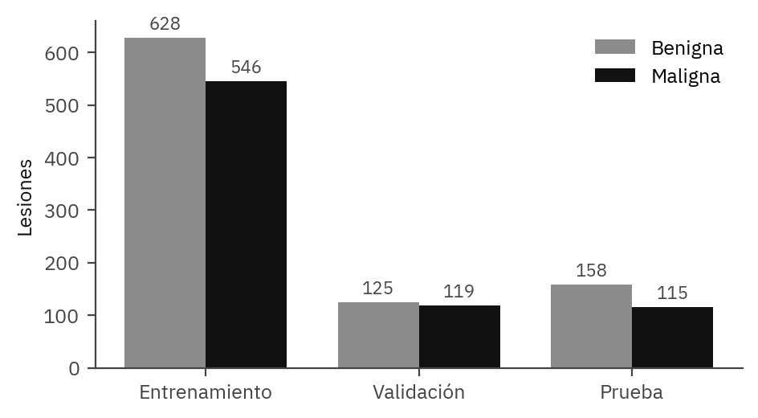
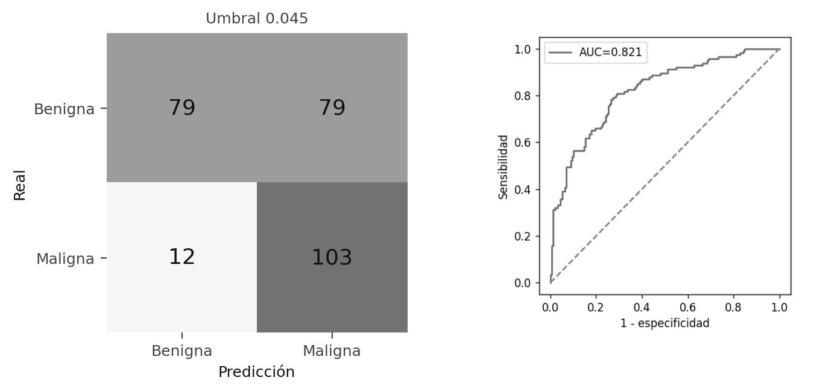
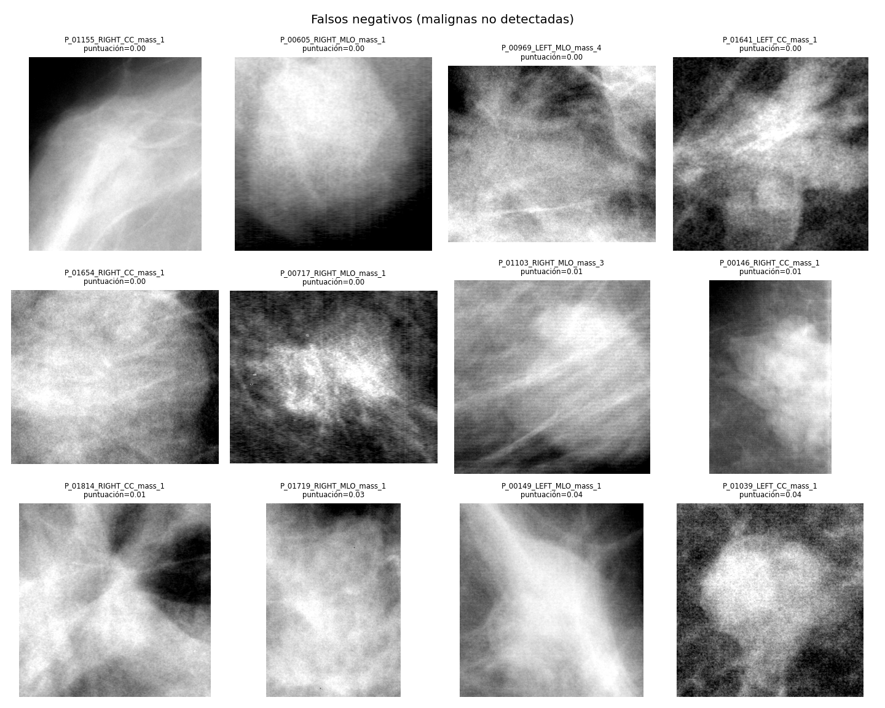

## Resumen

Se desarrolló un clasificador binario de recortes de masas mamográficas cuya etiqueta es el resultado histopatológico (benigno o maligno) registrado en el conjunto público CBIS-DDSM. El estudio incluyó 1.691 lesiones de 892 pacientes, distribuidas por paciente en particiones de entrenamiento, validación y prueba. Se comparó una red convolucional pequeña entrenada desde cero con una ResNet18 preentrenada en ImageNet, con y sin aumento de datos. Dado que el error de mayor costo es omitir una lesión maligna, el umbral de decisión se fijó en validación para alcanzar una sensibilidad mínima de 0,90. El modelo seleccionado, una ResNet18 con aumento de datos y umbral 0,045, obtuvo en el conjunto de prueba un ROC-AUC de 0,821, una sensibilidad de 0,896 y una especificidad de 0,500. La transferencia de aprendizaje superó ampliamente a la línea base (AUC de validación de 0,836 frente a 0,634); la limitación principal es la elevada tasa de falsos positivos.

*Palabras clave:* mamografía, CBIS-DDSM, transferencia de aprendizaje, ResNet18, sensibilidad, umbral de decisión.

> Prototipo académico, sin validación clínica. No debe emplearse para diagnóstico ni para tomar decisiones sobre pacientes.

## 1. Planteamiento del problema

La mamografía es la herramienta habitual de tamizaje del cáncer de mama. Ante una masa sospechosa, la confirmación de su naturaleza benigna o maligna se obtiene mediante biopsia. Este trabajo aborda una versión acotada de dicha tarea: a partir del recorte de una masa previamente localizada por un radiólogo, estimar si su resultado histopatológico es benigno o maligno.

La unidad de análisis es la lesión individual y no la paciente, la mama o el examen completo. La etiqueta corresponde a la columna `pathology` de CBIS-DDSM; no se utilizó la categoría BI-RADS, que expresa un grado de sospecha radiológica y no un diagnóstico confirmado. El modelo no detecta lesiones: recibe recortes ya delimitados. El público previsto son estudiantes y docentes de la asignatura.

Los dos tipos de error tienen consecuencias asimétricas. Un falso negativo, es decir, una lesión maligna clasificada como benigna, puede retrasar un tratamiento necesario. Un falso positivo genera estudios adicionales y ansiedad, pero su costo es menor. Por esta razón se dio prioridad a la sensibilidad de la clase maligna, aun a costa de la especificidad.

## 2. Datos

Se utilizó CBIS-DDSM (Lee et al., 2017), versión 1, distribuido por The Cancer Imaging Archive bajo licencia CC BY 3.0. Debido a que la colección completa ocupa cerca de 163,6 GB, el manifiesto de descarga se filtró con los identificadores de serie de los archivos de masas, y se obtuvieron únicamente los recortes y sus máscaras (1.799 series, 3.382 archivos DICOM, aproximadamente 27 GB).

| Aspecto | Valor |
|---|---|
| Registros en los CSV de masas | 1.696 |
| Registros con imagen disponible | 1.691 (5 excluidos por ausencia del DICOM) |
| Pacientes | 892 (1,9 lesiones por paciente en promedio; máximo 14) |
| Lesiones benignas | 911 (53,9 %) |
| Lesiones malignas | 780 (46,1 %) |

: Tabla 1. Composición del subconjunto utilizado.

Las categorías `BENIGN` y `BENIGN_WITHOUT_CALLBACK` se agruparon en la clase benigna, puesto que en ambas el estudio histopatológico descartó malignidad; `MALIGNANT` constituye la clase maligna. De las 911 lesiones benignas, 141 pertenecen a la segunda categoría, lo cual representa una simplificación que se discute en la sección 10.

Una misma paciente puede aportar varias lesiones y proyecciones. Si sus imágenes se distribuyeran entre entrenamiento y prueba, el modelo podría reconocer características de la paciente y no de la lesión, lo que inflaría las métricas. Por ello la partición se realizó con `GroupShuffleSplit`, agrupando por identificador de paciente y con semilla 42, y se verificó que ninguna paciente aparece en más de una partición. Las particiones se construyeron a partir de los archivos oficiales de entrenamiento y prueba combinados, de modo que no corresponden a la división original de CBIS-DDSM.

| Partición | Lesiones | Pacientes | Proporción de malignas |
|---|---|---|---|
| Entrenamiento | 1.174 | 624 | 46,5 % |
| Validación | 244 | 134 | 48,8 % |
| Prueba | 273 | 134 | 42,1 % |

: Tabla 2. Particiones por paciente.

## 3. Análisis exploratorio

{width=62%}

Las clases presentan un equilibrio razonable en las tres particiones, aunque la prueba contiene una menor proporción de lesiones malignas. Esta diferencia afecta a las métricas que dependen de la prevalencia, como la precisión, pero no al ROC-AUC.

Para descartar la existencia de atajos triviales se evaluó la capacidad discriminativa de variables simples consideradas de forma aislada. El área del recorte alcanzó un AUC de 0,570, el ancho y el alto 0,563 y 0,570, y la intensidad media 0,530. Aunque las lesiones malignas son en promedio algo mayores (381 × 373 frente a 355 × 350 píxeles), la variabilidad es alta y ninguna de estas variables separa las clases por sí sola. Ambas proyecciones (CC y MLO) y ambos lados están representados en las dos clases.

Los recortes presentan tamaños y proporciones muy diversos. Para no deformar la morfología de la lesión, cada imagen se completó con relleno negro hasta obtener un cuadrado antes de redimensionarla.

## 4. Metodología

**Preprocesamiento.** Las imágenes DICOM se convirtieron a 8 bits recortando la intensidad entre los percentiles 1 y 99, con el fin de evitar que valores extremos redujeran el contraste. Posteriormente se aplicó el relleno a formato cuadrado, el redimensionamiento a 224 × 224 píxeles, la replicación a tres canales y la normalización con las estadísticas de ImageNet. El aumento de datos (volteo horizontal, rotación de hasta 10° y variaciones leves de brillo y contraste) se aplicó exclusivamente durante el entrenamiento.

**Modelos.** Como línea base se entrenó desde cero una red convolucional pequeña (tasa de aprendizaje 1e-3). El modelo principal fue una ResNet18 (He et al., 2016) preentrenada en ImageNet y ajustada en todas sus capas con Adam (tasa de aprendizaje 1e-4, lotes de 32, 15 épocas). Con apenas 1.174 lesiones de entrenamiento, reutilizar filtros previamente aprendidos resulta más adecuado que aprenderlos desde cero. En ambos casos se emplearon pesos de clase en la función de pérdida y se conservó la época con mayor ROC-AUC en validación.

**Umbral de decisión.** En lugar del umbral convencional de 0,5, se seleccionó en validación el mayor umbral que garantiza una sensibilidad de al menos 0,90. El conjunto de prueba no intervino en ninguna decisión: se evaluó una única vez, con el modelo y el umbral ya fijados.

## 5. Experimentos en validación

El conjunto de validación contiene 244 lesiones, de las cuales 119 son malignas y 125 benignas. La Tabla 3 resume los tres modelos con el umbral correspondiente a una sensibilidad de 0,908.

| Modelo | AUC | Umbral | Sensibilidad | Especificidad | FP | FN |
|---|---|---|---|---|---|---|
| CNN pequeña (línea base) | 0,634 | 0,344 | 0,908 | 0,128 | 109 | 11 |
| ResNet18 con aumento | 0,836 | 0,045 | 0,908 | 0,512 | 61 | 11 |
| ResNet18 sin aumento | 0,837 | 0,075 | 0,908 | 0,592 | 51 | 11 |

: Tabla 3. Comparación de modelos en validación.

La red entrenada desde cero apenas aprendió: su pérdida de validación permaneció cerca de 0,69, valor equivalente a una predicción aleatoria, y con umbral 0,5 solo identificó 23 de las 119 lesiones malignas. Con la misma sensibilidad, la ResNet18 redujo los falsos positivos de 109 a 61. La transferencia de aprendizaje incrementó el AUC en 0,20 puntos.

La ResNet18 con aumento mostró sobreajuste: la pérdida de entrenamiento descendió hasta 0,113, mientras que la de validación pasó de 0,52 en la segunda época a 0,69 al final, con un máximo de 0,85. En consecuencia, el AUC de 0,836 debe interpretarse con cautela, ya que oscila alrededor de ±0,03 entre épocas.

Para evaluar el efecto del aumento de datos se repitió el entrenamiento modificando únicamente ese factor y manteniendo semilla, partición y número de épocas. Sin aumento, el sobreajuste fue más pronunciado (pérdida de entrenamiento de 0,011 y pérdida de validación de hasta 1,14), aunque el AUC fue prácticamente idéntico y, con igual sensibilidad, se obtuvieron 10 falsos positivos menos.

Ambas variantes de ResNet18 coinciden en AUC y sensibilidad. Se eligió como modelo final la variante con aumento de datos por la mayor estabilidad de su entrenamiento: la alternativa memorizó casi por completo el conjunto de entrenamiento, y una diferencia de 10 falsos positivos observada en una sola ejecución no constituye evidencia suficiente para preferirla. La elección se realizó antes de evaluar el conjunto de prueba.

| Umbral | VN | FP | FN | VP | Sensibilidad | Especificidad | Exactitud |
|---|---|---|---|---|---|---|---|
| 0,50 | 99 | 26 | 37 | 82 | 0,689 | 0,792 | 0,742 |
| 0,30 | 90 | 35 | 28 | 91 | 0,765 | 0,720 | 0,742 |
| 0,045 | 64 | 61 | 11 | 108 | 0,908 | 0,512 | 0,705 |

: Tabla 4. Efecto del umbral en la ResNet18 con aumento (validación).

Los umbrales 0,5 y 0,3 producen la misma exactitud, pero el segundo detecta nueve lesiones malignas adicionales, lo que muestra que la exactitud no es un criterio adecuado para este problema. Cada lesión maligna recuperada al reducir el umbral implica entre uno y uno y medio falsos positivos adicionales. El valor seleccionado, 0,045, es bajo porque el modelo sobreajustado produce puntuaciones muy próximas a 0 o a 1; por ello la puntuación no debe interpretarse como una probabilidad.

## 6. Evaluación en el conjunto de prueba

El modelo final se evaluó una sola vez sobre las 273 lesiones de prueba (115 malignas y 158 benignas), con el umbral fijado en validación.

| Métrica | Validación | Prueba |
|---|---|---|
| ROC-AUC | 0,836 | 0,821 |
| Sensibilidad | 0,908 | 0,896 |
| Especificidad | 0,512 | 0,500 |
| Precisión | 0,639 | 0,566 |
| F1 | 0,750 | 0,694 |
| Exactitud | 0,705 | 0,667 |
| VN / FP / FN / VP | 64 / 61 / 11 / 108 | 79 / 79 / 12 / 103 |

: Tabla 5. Desempeño del modelo final.

{width=86%}

Los resultados de prueba son consistentes con los de validación: el AUC disminuye 0,015 y la sensibilidad 0,012. Esta coherencia indica que el umbral se mantiene en datos no vistos y que no se produjo fuga de información entre particiones. La precisión desciende en mayor medida porque la prueba tiene una prevalencia de lesiones malignas más baja; con la misma especificidad, una fracción mayor de las alertas corresponde a falsos positivos. En términos absolutos, el modelo identifica 103 de las 115 lesiones malignas y señala como sospechosas 79 de las 158 benignas.

## 7. Análisis de errores

Los doce falsos negativos de prueba recibieron puntuaciones inferiores a 0,039, y cinco de ellas fueron menores que 0,002. El modelo, por lo tanto, no presenta incertidumbre frente a estos casos, sino que los considera claramente benignos; una reducción moderada del umbral no permitiría recuperarlos sin aumentar de forma considerable los falsos positivos. Los errores se reparten por igual entre proyecciones (seis CC y seis MLO), con ocho lesiones del lado derecho y cuatro del izquierdo, y corresponden a doce pacientes distintas. En validación se observó el mismo comportamiento, con once falsos negativos de puntuación inferior a 0,03.

{width=88%}

La inspección visual sugiere dos grupos. En cerca de la mitad de los casos el recorte está dominado por tejido denso y la masa apenas se diferencia de su entorno. En otros tres (P_00605, P_00146 y P_01039) la masa es redondeada y de bordes relativamente definidos, un aspecto que suele asociarse a lesiones benignas, lo que podría explicar la seguridad con que el modelo las descarta. Con doce casos, esta interpretación es una hipótesis que requeriría más datos o la valoración de un especialista.

Los 79 falsos positivos constituyen el costo de priorizar la sensibilidad. Con un umbral de 0,5 su número sería considerablemente menor, pero se perdería cerca de un tercio de las lesiones malignas.

## 8. Contraste de hipótesis

Las hipótesis H1 y H2 se formularon antes del entrenamiento y se reformularon el 19 de noviembre con criterios cuantitativos, cuando los resultados ya eran conocidos; la versión original se conserva en el historial del repositorio. La hipótesis H3 se planteó antes del experimento sin aumento de datos.

| Hipótesis | Criterio | Resultado | Conclusión |
|---|---|---|---|
| H1. La ResNet18 preentrenada supera a la red pequeña | Diferencia de AUC mayor que 0,05 | 0,836 frente a 0,634 | Se cumple |
| H2. Con umbral 0,5 la sensibilidad es menor que la especificidad, y alcanzar 0,90 reduce la especificidad | Sensibilidad y especificidad con ambos umbrales | 0,689 y 0,792; luego 0,908 y 0,512 | Se cumple |
| H3. Sin aumento de datos aumenta el sobreajuste y disminuye el AUC | Pérdida y AUC de validación | Mayor sobreajuste (1,14 frente a 0,85); AUC similar (0,837 frente a 0,836) | Se cumple parcialmente |

: Tabla 6. Resultado de las hipótesis.

El resultado de H3 indica que, en este caso, el aumento de datos estabilizó el entrenamiento sin mejorar la capacidad de ordenar las lesiones. Al tratarse de una única ejecución con una sola semilla, se considera un indicio y no un resultado general.

## 9. Interfaz

Se implementó una interfaz web con Gradio que recibe el recorte de una lesión en formato PNG, JPG, BMP o WEBP, aplica el mismo preprocesamiento del entrenamiento y muestra la clase asignada, la puntuación del modelo, el umbral y un aviso sobre el carácter no clínico de la herramienta. Las imágenes vacías o menores de 32 × 32 píxeles se rechazan. En la verificación con imágenes de validación, una lesión maligna (puntuación 0,206) y una benigna (0,036) se clasificaron correctamente, y una imagen vacía fue rechazada. La interfaz incluye estos dos recortes y uno de los falsos negativos como ejemplos que se cargan con un clic y puede ejecutarse sin GPU. Para que el prototipo pueda consultarse sin instalar nada, el modelo final se exportó al formato ONNX y se publicó una página web estática en Hugging Face Spaces que realiza la inferencia en el navegador con ONNX Runtime Web y reproduce el mismo preprocesamiento. En los tres ejemplos, las puntuaciones de la página coincidieron con las de PyTorch (diferencia máxima de 2 × 10⁻⁶). Los enlaces y el procedimiento se describen en el Anexo A.

## 10. Limitaciones y consideraciones éticas

Los resultados se obtuvieron con un único conjunto de datos, compuesto por mamografías de película digitalizadas, y solo con masas; no es posible asumir que se generalicen a otras instituciones, equipos o a la mamografía digital actual. El modelo clasifica recortes ya localizados y no realiza detección. Cada configuración se entrenó una sola vez con una semilla, y el conjunto de validación incluye 244 lesiones, por lo que las métricas tienen una incertidumbre apreciable. La especificidad de 0,50 implica que la mitad de las lesiones benignas se clasifican como sospechosas. Las puntuaciones no están calibradas y no representan probabilidades. Finalmente, la agrupación de las categorías benignas simplifica la realidad clínica. Por todo lo anterior, el sistema es un prototipo educativo y no debe usarse en la atención de pacientes.

## 11. Reproducibilidad

Las particiones y los entrenamientos usan la semilla 42, y la configuración de cada ejecución se guarda en `runs/<ejecución>/config.json`. La evaluación final se realizó en Google Colab con Python 3.13.16, PyTorch 2.14.1, torchvision 0.29.1 y una GPU Tesla T4; las versiones exactas se encuentran en `requirements-lock.txt` y `entorno.json`. El entrenamiento del modelo final requirió 167,7 segundos. El código, el modelo final entrenado (`runs/resnet18_base/best.pt`) y los resultados de todas las ejecuciones están disponibles en el repositorio https://github.com/a23andres1223-source/mamografias-ac. La demostración en línea se encuentra en https://andres1223-mamografias.static.hf.space. El flujo completo y los comandos se describen en el archivo `README.md`, las decisiones del proceso en `bitacora.md` y el uso de herramientas de inteligencia artificial en `registro_ia.md`.

## 12. Conclusiones

La transferencia de aprendizaje fue el factor de mayor impacto: con poco más de mil lesiones de entrenamiento, la red entrenada desde cero no logró aprender, mientras que la ResNet18 preentrenada alcanzó un AUC de 0,836 en validación y de 0,821 en prueba. La partición por paciente y la selección del umbral exclusivamente en validación produjeron resultados de prueba coherentes con los de validación. La prioridad dada a la sensibilidad permitió detectar cerca del 90 % de las masas malignas, a cambio de una especificidad de 0,50, que constituye la principal debilidad del modelo. Como trabajo futuro se propone incorporar más datos, incluidas las calcificaciones, repetir los entrenamientos con distintas semillas, calibrar las puntuaciones y validar el modelo con datos de otra institución.

## Referencias

Clark, K., Vendt, B., Smith, K., Freymann, J., Kirby, J., Koppel, P., Moore, S., Phillips, S., Maffitt, D., Pringle, M., Tarbox, L. y Prior, F. (2013). The Cancer Imaging Archive (TCIA): Maintaining and operating a public information repository. *Journal of Digital Imaging, 26*(6), 1045–1057.

He, K., Zhang, X., Ren, S. y Sun, J. (2016). Deep residual learning for image recognition. En *Proceedings of the IEEE Conference on Computer Vision and Pattern Recognition* (pp. 770–778).

Lee, R. S., Gimenez, F., Hoogi, A. y Rubin, D. (2016). *Curated Breast Imaging Subset of DDSM* [Conjunto de datos]. The Cancer Imaging Archive. https://doi.org/10.7937/K9/TCIA.2016.7O02S9CY

Lee, R. S., Gimenez, F., Hoogi, A., Miyake, K. K., Gorovoy, M. y Rubin, D. L. (2017). A curated mammography data set for use in computer-aided detection and diagnosis research. *Scientific Data, 4*, 170177.

## Anexo A. Ejecución del prototipo {#anexo}

**Demostración en línea, sin instalar nada.** El prototipo está publicado en https://andres1223-mamografias.static.hf.space (página del proyecto en Hugging Face: https://huggingface.co/spaces/Andres1223/mamografias). Basta con abrir el enlace, esperar a que cargue el modelo (45 MB) y hacer clic en uno de los ejemplos o subir un recorte. La página ejecuta el modelo final, convertido a formato ONNX, dentro del navegador mediante ONNX Runtime Web, con el mismo preprocesamiento de la interfaz Gradio; la imagen no se envía a ningún servidor.

**Más imágenes para probar.** Los 1.691 recortes en PNG están disponibles en una carpeta de Google Drive de solo lectura: https://drive.google.com/drive/folders/1aVHj3Scb4ZAW-S-Llsub6KrvAp352mh3. Cada archivo se nombra con el identificador de la lesión (por ejemplo, `P_00009_RIGHT_CC_mass_1.png`). Si se conserva ese nombre, la página en línea muestra junto al resultado la patología real y la partición a la que pertenece la lesión, tomadas de `web/etiquetas.csv`. Las lesiones de la partición de prueba ya se usaron en la evaluación final.

**Interfaz Gradio en un computador propio** (Windows, macOS o Linux; requiere Python 3.10 a 3.13 y Git). El repositorio incluye el modelo final y tres recortes de validación en `ejemplos/`, por lo que no se necesita GPU ni descargar el conjunto de datos. En una terminal:

```
git clone https://github.com/a23andres1223-source/mamografias-ac.git
cd mamografias-ac
python -m venv .venv
.venv\Scripts\activate          (macOS/Linux: source .venv/bin/activate)
pip install -r requirements.txt
python app.py
```

La interfaz se abre en `http://127.0.0.1:7860`. La primera instalación tarda unos minutos porque descarga PyTorch.

**Interfaz Gradio en Google Colab.** En una celda de un cuaderno nuevo:

```
!git clone https://github.com/a23andres1223-source/mamografias-ac.git
%cd mamografias-ac
!pip -q install gradio
!python app.py --share
```

Tras unos 30 segundos aparece un enlace `https://….gradio.live` que abre la interfaz.

**Uso.** Se carga un recorte (PNG, JPG, BMP o WEBP) o se elige un ejemplo y se pulsa *Clasificar*. Se muestran la clase asignada, la puntuación del modelo y el umbral de 0,045. Los ejemplos ilustran un acierto benigno, un acierto maligno y un falso negativo, este último analizado en la sección 7.

: Ejemplos incluidos en la demostración y en el repositorio

| Archivo | Patología real | Resultado del modelo |
|---|---|---|
| `benigna_P_00021_LEFT_CC_mass_1.png` | Benigna | Benigna (0,036) |
| `maligna_P_00009_RIGHT_CC_mass_1.png` | Maligna | Maligna (0,206) |
| `maligna_falso_negativo_P_01744_LEFT_MLO_mass_1.png` | Maligna | Benigna (0,002) |

Las métricas, curvas, matrices de confusión y listados de errores de cada modelo están en `runs/<modelo>/`. La guía detallada está en `GUIA_PROFESOR.md` y los pasos para repetir el entrenamiento, en la sección «Cómo reproducir» del `README.md`.
